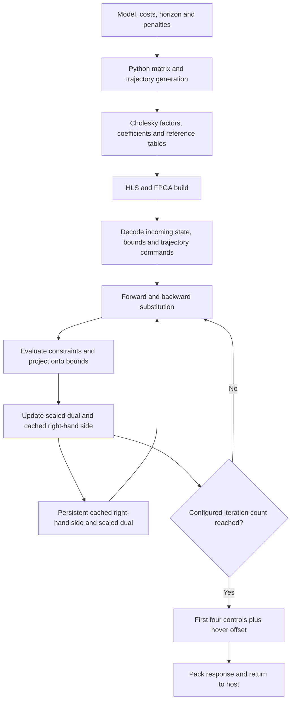

# How one FPGA solve works

Each solver call receives a measured drone state and returns four motor commands.
It predicts a sequence of states and controls, performs a fixed number of ADMM
iterations, and returns only the first control in that sequence. The next call
uses a new measurement and retains numerical state from the previous solve.

This walkthrough connects the optimization problem to the implementation in
[ADMM.cpp](../vitis_projects/ADMM/ADMM.cpp). For packet layouts and model conventions,
see [Design and interfaces](architecture.md); for commands, see
[Build and program](build.md).

## From model generation to a motor command



The matrix factorization happens on the host before compilation. The FPGA reuses
the resulting constants for every solve; it does not factor a new matrix when a
measurement arrives.

## The optimization problem

Use `s_k` for a predicted 12-component state and `v_k` for four motor commands
relative to hover. With horizon `H`, the optimization vector is

```text
w = [s_0, v_0, s_1, v_1, ..., s_H]
```

It contains `16H + 12` variables. The source calls this entire vector `x`; it is
larger than the single measured state supplied to the controller.

The quadratic program is

```text
minimize    1/2 wᵀ P w + qᵀ w
subject to  l ≤ C w ≤ u
```

Here `C` denotes the full constraint matrix, named `A_full` in Python. It must be
distinguished from the small dynamics matrix `A` used in `s_(k+1) = A s_k + B v_k`.
The Hessian `P` has alternating `Q` and `R` blocks, ending with `Q` for the terminal
state. The current generator uses terminal cost `Q`, without an additional LQR
terminal-cost calculation.

The constraint rows are arranged as follows:

| Rows | Expression in `C w` | Projection target |
|---|---|---|
| Initial state, 12 rows | `s_0` | Measured state |
| Dynamics, `12H` rows | `s_(k+1) - A s_k - B v_k` | Zero |
| Inputs, `4H` rows | `v_k` | Compiled motor bounds relative to hover |
| Position, `2H` rows | x and y components of `s_1` through `s_H` | Static or selected dynamic bounds |

There are `18H + 12` rows in total. Equalities are represented by identical lower
and upper bounds. For the default `H=27`, this gives 444 variables and 498 rows.

The linear term `q` pulls predictions toward the reference. In the production
trajectory path, only the three position components have nonzero reference
terms: `q_position = -Q_position * reference_position`. Other linear terms are
zero. With trajectory playback inactive or compiled out, the production solver
uses `q=0`. The benchmark helper can instead accept an explicit full `q` vector.

## What Python computes offline

[parameters.py](../scripts/parameters.py) selects the horizon, cost weights,
penalties, numerical mode and trajectory settings.
[header_generator.py](../scripts/header_generator.py) obtains the linearized
discrete dynamics from [crazyflie_model.py](../scripts/crazyflie_model.py), assembles
the problem and computes its factorization.

Let `D` be a diagonal matrix of ADMM penalties: equality rows use `rho_eq`, while
input and position inequality rows use `rho_ineq`. The matrix solved during each
iteration is

```text
K = P + Cᵀ D C
K = L Lᵀ
```

The generator calls this matrix `KKT`. It uses CHOLMOD with natural ordering,
then exports banded representations of `L` and `Lᵀ`. Diagonal entries in the
exported solve representation are stored as reciprocals so the runtime can
multiply instead of divide. The generated penalties are powers of two, allowing
fixed-point penalty multiplication to use shifts.

[trajectory_generator.py](../scripts/trajectory_generator.py), particularly
`build_traj_q_packed`, stores the position-reference cost terms in a compact
table. Extra rows provide horizon lookahead across the loop boundary.

Generated artifacts include `data.h`, `admm_runtime_config.h`, `traj_data.h` and
the RTL parameter header. HLS compiles these constants together with the solver.
Changes to dynamics, costs, horizon or penalties require regeneration and a
matching build. Changing runtime bound values keeps `C` and `K` unchanged;
changing constraint directions or topology requires a new matrix and factorization.

## Decode one request

`ADMM_solver` unpacks 418 input bits into twelve state words, one packed bound
word, and two trajectory command bits, then calls `ADMM_solver_core`.

The core processes trajectory reset before start. Reset returns playback to the
beginning and stops it; start enables it. Setting both starts playback from the
beginning. These commands do not clear the persistent ADMM arrays.

The bound word contains signed 16-bit minimum and maximum values in millimetres.
A zero word selects compiled defaults. A nonzero word replaces the position
bounds only for `DYNAMIC_CONSTRAINT_AXIS` at stages greater than or equal to
`DYNAMIC_CONSTRAINT_START_STAGE`. Other position rows retain their static bounds.
See `use_dynamic_constraint_stage` for that selection.

The state, bounds and reference index remain fixed throughout this call's
iteration loop.

## One ADMM iteration

ADMM introduces an auxiliary constraint-space vector `z`. Projection makes `z`
satisfy the bounds, while the dual update pushes `C w` toward `z`. The code stores
the scaled dual `y = D⁻¹ lambda` and caches `b = Cᵀ D (z - y)`.

In ideal arithmetic, each call to `ADMM_iteration` performs:

```text
1. Solve K w = b - q
2. a = C w
3. z = clip(a + y, l, u)
4. y = y + a - z
5. b = Cᵀ D (z - y)       # uses the updated y
```

`forward_substitution_impl` solves `L t = b - q` and
`backward_substitution` solves `Lᵀ w = t`. Both walk through the stored bands
using a small window of previously computed values.

Projection is row-local. An initial-state row sets `z` directly to its measured
state component. A dynamics row sets `z=0`. Input and position rows clamp
`a+y` between their lower and upper bounds. The implementation immediately
updates `y` and stores `D(z-y)` in temporary `b_tmp`; it does not retain a separate
full `z` array. `AT_mul` then applies `Cᵀ` to produce the next `b`.

This order matters on a new request: the first triangular solve uses the cached
`b` and the current `q`. The new measurement and bound values first enter through
that iteration's projection, affecting the following triangular solve. A cold
start has `b=0` and `y=0`; with `q=0`, its first primal vector is also zero.

## Warm starts and the complete call

The production core declares `x`, `b` and `y` as static arrays initialized to
zero. They persist between calls.
Although `x` persists too, the next triangular solve overwrites it; the carried
`b` and `y` provide the numerical warm start.

```text
persistent w = 0, b = 0, y = 0
persistent playback state

on each request:
    unpack measured state, bounds and playback commands
    update playback state and select q for its current index
    select l and u from measured state and compiled/runtime bounds

    repeat exactly ADMM_ITERATIONS times:
        t = forward_solve(L, b - q)
        w = backward_solve(Lᵀ, t)
        a = C w
        z = clip(a + y, l, u)
        y = y + a - z
        b = Cᵀ D (z - y)

    advance playback counter if playback is enabled
    return pack(w[12:16] + hover)
```

Projection constrains the auxiliary `z`, while the returned controls come from
the primal vector `w`. The output path adds hover without a separate explicit
clamp to the motor bounds.

`ADMM_benchmark_solve` differs from the production core: it uses local zeroed
arrays for each invocation, accepts an explicit `q`, and returns the entire
primal vector. A cold-start benchmark is therefore different from repeated
production calls with persistent warm starts.

## Full sparse and staged A implementations

Both architectures use the same variable ordering, constraint rows, ADMM update
and public interface. They also both retain horizon-dependent Cholesky factors
and work arrays.

| Operation | `full_sparse` | `staged_a` |
|---|---|---|
| Evaluate `C w` | Read stored coefficients and indices of expanded constraint rows | Compute initial-state, dynamics, input and position rows directly by stage |
| Apply `Cᵀ` | Read stored coefficients and indices of the expanded transpose | Accumulate stage contributions using the small dynamics `A` and `B` |
| Solve with `K` | Banded forward/backward substitution | Banded forward/backward substitution |

Staged-A avoids storing copies of the same dynamics coefficients across the
horizon. This reduces expanded-operator storage, but does not make the complete
solver's storage independent of horizon. Its arithmetic order also differs, so
fixed-point results need not be bit-identical between architectures. Achieved
latency and resource tradeoffs must be read from synthesis and implementation
reports.

## Arithmetic and timing

The default numerical type is `ap_fixed<32,10,AP_RND,AP_SAT>`: 22 fractional bits
with rounding and saturation. Main dot-product accumulators add eight integer
guard bits, using 40 total bits and the same fractional precision. Intermediate
casts still quantize values, so the equations above describe the mathematical
update rather than every rounding operation. See
[data_types.h](../vitis_projects/ADMM/data_types.h) and `acc_t` in the solver.

The integer-bit count includes the sign bit. Thus `fp_t` represents
`[-512, 512 - 2^-22]`, with resolution `2^-22` (approximately `2.384e-7`).
The default `acc_t` represents `[-131072, 131072 - 2^-22]`. `AP_RND` rounds
to the nearest representable value, resolving halfway cases toward positive
infinity; `AP_SAT` clamps overflow to the destination type's endpoints.
These rules apply when values are assigned or converted to the destination
fixed-point type, not as a blanket rule for every intermediate expression.
See AMD's [quantization modes](https://docs.amd.com/r/2023.2-English/ug1399-vitis-hls/Quantization-Modes).

The implementation uses a common binary point rather than per-variable or
block-floating scaling. Model coefficients, costs, and cached factors are
converted to `fp_t`; the model's physical coordinates and normalized motor
commands are retained, with inputs expressed relative to hover. The separate
packed dynamic-bound fields use signed integer millimetres and are converted
to metres on entry. This transport encoding is distinct from the solver's
22-bit fractional representation.

Penalty shifts use a separate intermediate `rho_acc_t`, with
`32 + max(RHO_SHIFT_EQ, RHO_SHIFT_INEQ)` total bits and
`10 + max(RHO_SHIFT_EQ, RHO_SHIFT_INEQ)` integer bits, retaining 22 fractional
bits. It uses `AP_TRN, AP_WRAP`; the extra integer bits accommodate the configured
left shifts before conversion back to saturating `fp_t`. Right shifts discard
low bits. Consequently, not every internal type uses `AP_RND, AP_SAT`.
These representable ranges describe the arithmetic, not a guarantee that
all problem instances avoid saturation or meet a given optimization tolerance.

Three timing quantities have separate roles: the model timestep, the interval
between solver calls, and the reference playback interval. Defaults use a 50 Hz
model and advance playback every 20 calls; at a 1 kHz invocation rate both the
model and playback intervals are 20 ms. Playback advances after solving, so the
current request uses the reference index selected at entry.

The returned 128-bit value holds four 32-bit commands. SPI or UART framing belongs
to the board top level, outside the numerical solver. Reported solver cycles
therefore exclude transport time; consult the
[benchmark definitions](benchmarking.md#energy-and-timing-definitions) when
comparing compute latency with the complete control period.
