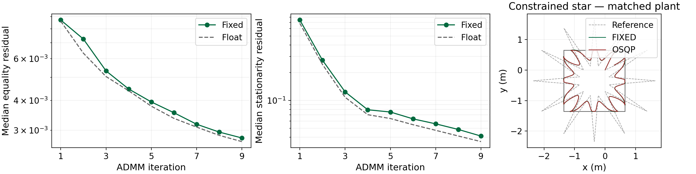

# Evaluation results

These results use the bundled benchmark and flight data, plus the numerical
simulation described below. Preview figures are included in `figures/` so this
page can be read directly on GitHub or in a fresh checkout. Full generated
exports are written to untracked `output/`.

See [regeneration instructions](#regenerate) to recreate the analysis and
[benchmark methodology](../docs/benchmarking.md) for measurement definitions
and the scope of the supplied experiment data.

## Solver benchmarks

The [benchmark CSV](data/benchmark_summary.csv) contains MCU timing measurements,
implementation estimates and failed points. The table uses the same row selection
as `plot_benchmarks.py`: timing-clean implementations, lowest latency then lowest
power, with the figure's explicit readability exclusions. The default comparison
uses 10 iterations; the common-horizon resource comparison is H40.

Both post-route power estimates and Arty measurements are available. At the
measured configurations, the post-route benchmark estimates give more conservative
power values. The latency/energy and EDP figures use measured Arty core/BRAM power
plus matching estimated auxiliary/I/O supply contributions (VCCADC excluded because
it is tied to ground in the custom PCB), with energy and EDP calculated using the
campaign's measured solve latency. Bubble positions retain synthesis-derived FPGA
timing for the latency comparison. 
TinyMPC uses its recorded timing and a 287.1 mW active-power estimate. Both energy
and EDP exclude communication and board support circuitry. Asterisked bubbles use
post-route estimates where instrumented measurement builds failed; unmeasured
configurations remain absent from the EDP comparison. The resource table and maximum-horizon results also use implementation reports;
they do not imply 1 kHz operation at the largest horizons. See [benchmark methodology](../docs/benchmarking.md#energy-and-timing-definitions)
for measurement boundaries and the separate 100 µs feasibility reserve.
The architecture radar uses measured latency and core/BRAM energy plus estimated
auxiliary/I/O energy, matching the EDP comparison. Its BRAM/LUT utilization and
maximum horizons come from implementation reports. The “Logic” axis is LUT
utilization as a percentage of the device's LUT capacity (34.9% staged versus
14.6% full_sparse at H40); register utilization is reported separately in the table.

The [device power comparison CSV](data/device_power_comparison.csv) compares
routed Artix-7 50T designs with matching 100T estimates using the same
architecture, horizon and 10 ADMM iterations. Power is Vivado total on-chip power 
in watts. The percentage change is `100 * (50T / 100T - 1)`. The CSV also records 
50T distributed RAM LUT and BRAM tile counts.

<!-- BEGIN GENERATED BENCHMARKS -->

| H40 / 10 iterations | Solve (ms) | Energy (mJ) | EDP (mJ·ms) |
| --- | --- | --- | --- |
| Staged FPGA | 1.339 | 0.424 | 0.568 |
| Full-sparse FPGA | 1.484 | 0.412 | 0.612 |
| TinyMPC | 20.899 | 6.000 | 125.396 |

| H40 FPGA resources | LUTs | FFs | BRAM tiles | DSPs |
| --- | --- | --- | --- | --- |
| Staged FPGA | 22127 | 26540 | 36 | 80 |
| Full-sparse FPGA | 9280 | 12051 | 78.5 | 77 |

| Largest recorded timing-clean horizon | Horizon | Variables | Constraints | Solve (ms) |
| --- | --- | --- | --- | --- |
| Full-sparse FPGA | 90 | 1452 | 1632 | 3.295 |
| Staged FPGA | 1350 | 21612 | 24312 | 44.859 |

<!-- END GENERATED BENCHMARKS -->


## Numerical accuracy

The current H27/k9 analysis uses the actual C++ solver and persistent warm starts.
Independent fixed, float and OSQP closed-loop trajectories use a generated
figure-eight and nonlinear plant. The command-error comparison instead replays
identical fixed-rollout inputs through float and OSQP, avoiding trajectory
feedback differences. These are reconstructed simulations, separate from flights.
All three command-error comparisons use the same 25,600 control instants.
Each error is the maximum absolute difference across the
four motor commands.

<!-- BEGIN GENERATED NUMERICS -->

```text
H27 / 9 iterations / figure-eight / persistent warm start

First-command error distribution (normalized motor units):
Per-instant error = max absolute difference across the four motor commands.
Inputs match across solvers at each instant; instants come from one trajectory.
Std is population standard deviation; percentiles use linear interpolation.
Comparison       Samples          Min         Mean          Std       Median          P95          P99          Max
  fixed–float     25600  5.96046e-08  1.85024e-05  1.36375e-05   1.4782e-05  4.72665e-05  4.95911e-05   5.1856e-05
  fixed–OSQP      25600  6.27034e-08  0.000774416  0.000725098  0.000610885   0.00221414   0.00354063   0.00518347
  float–OSQP      25600  3.09876e-09  0.000764815  0.000720861  0.000600955   0.00219602   0.00351816   0.00515903

Controller   Tracking RMSE (m)   Max XY-bound violation (m)
  fixed      0.05672986          0
  float      0.05672938          0
  osqp       0.05663985          0
```

<!-- END GENERATED NUMERICS -->

The numerical simulation command below generates `output/numerical_convergence.png`.
The bundled star result is shown below.

### Constrained-star comparison with OSQP

The star reference contains sharp corners and deliberately extends beyond the
admissible XY box. Tracking error therefore reflects the reference geometry,
constraints and controller dynamics as well as numerical solution accuracy.
To contextualize the recorded flight's tracking error, we compare the fixed-point
and float implementations with OSQP on the same star reference in simulation.
The fixed-point and float solvers use H27/k9 and persistent warm starts; OSQP
solves the same constrained MPC problem to its configured tolerances.

All controllers use the same plant, hard XY bounds and motor limits, and update
at 1 kHz. The plant model is regenerated at 1 ms while the MPC prediction timestep
remains 20 ms. The reference is checked against the star reference CSV. Tracking
RMSE covers the feasible-reference portions of one 25 s cycle: 12,040 of 25,000
samples (48.16%).

| Controller | 3D RMSE (cm) | Max XY violation over full rollout (cm) |
| --- | --- | --- |
| Fixed-point | 19.5297 | 1.3363 |
| Float | 19.4932 | 1.3382 |
| OSQP | 19.6230 | 0.002328 |



The right-hand panel overlays the fixed-point trajectory (green), OSQP trajectory
(red), recorded reference (dashed grey) and hard XY box. The left and middle
panels show fixed-point and float solver residuals. This figure shows simulated
trajectories, not the recorded flight.

The trajectory overlay shows similar corner rounding, and the three controllers
achieve comparable tracking RMSE. Thus, the star's tracking error also occurs
when OSQP solves the MPC problem: it cannot be attributed solely to the FPGA
solver's fixed iteration budget or arithmetic. This supports interpreting the
flight RMSE in the context of this demanding reference, rather than judging
solver quality from its absolute magnitude alone.


## Penalty-parameter sensitivity

`rho_saturation_sweep.py` runs a fixed sweep comparing equality/inequality 
penalties at ten ADMM iterations, using the same figure-eight and star inputs
in float and native `ap_fixed<32,10,AP_RND,AP_SAT>` arithmetic. Inputs are 
regenerated when no valid cache exists; candidate commands are not fed back into the plant.

```bash
OPENBLAS_NUM_THREADS=1 ~/venv/bin/python evaluation/rho_saturation_sweep.py \
  --hls-include /path/to/Vitis/include --jobs 8
```

Requires NumPy, SciPy, scikit-sparse, OSQP, g++, and AMD HLS headers. The full
native sweep is expensive; each invocation evaluates all candidates.
`--output` selects the results directory (default `output/rho_saturation/`).
Production files and installed headers are never modified.

The workload has 64 windows per trajectory, each with up to 32 preceding
inputs: 4,160 replay inputs total. At most four inputs may have any native
saturation (0.1%). Factor saturation and nonfinite values reject a candidate.
Infeasible QPs remain in saturation screening; command error uses 118 feasible
reference QPs. OSQP uses explicit polishing and absolute/relative tolerances
of 1e-7. The ranking metric is mean float first-command infinity-norm error;
fixed arithmetic determines eligibility. Monitoring includes implicit native
saturating conversions and guarded accumulators. Unrestricted rho uses an
evaluation-only wide multiplier; power-of-two rho retains shifts.

| Best tested choice | Equality rho | Inequality rho | Mean float command error |
| --- | ---: | ---: | ---: |
| Power of two | 128 | 32 | 0.01232 |
| Unrestricted | 152.2185 | 38.0546 | 0.01099 |

The relative mean-error increase is **12.04%**.
Selection and reporting use the same trajectories, without held-out validation.

The [candidate CSV](data/rho_saturation_candidates.csv) records the completed
sweep and supplies only the candidate rho columns to fresh runs; all outcomes
are recomputed. New outputs remain under ignored
`output/` and do not replace this bundled evidence automatically.

## Recorded flights

The figure-eight overlay is a trajectory visualization, not a new
synchronized tracking-error measurement.


The following table quantifies **position-constraint violation**. Star values use
the larger of the x/y violations per sample. Dynamic values use the complete dynamic-obstacle
recording and last transmitted x bounds.
RMS includes zero violations; percentages are sample-weighted with repeated
motion-capture frames retained. These values do not measure obstacle clearance.
See [flight methodology and limitations](../docs/flight-analysis.md).

The distribution statistics include zero violations; standard deviation is over
the full evaluated population. “Violation ≤1 cm” includes samples inside the
bounds. These are percentages of logged samples, not continuous-time durations.

<!-- BEGIN GENERATED FLIGHTS -->

| Recording | Samples | Max violation (cm) | RMS violation (cm) | Outside (%) |
| --- | --- | --- | --- | --- |
| dynamic_obstacle | 6639 | 4.5048 | 0.3386 | 3.449 |
| constrained_star | 3752 | 3.1325 | 0.5070 | 11.354 |

| Recording | Inside bounds (%) | Violation ≤1 cm (%) | Mean (cm) | Std (cm) | P95 (cm) | P99 (cm) |
| --- | --- | --- | --- | --- | --- | --- |
| dynamic_obstacle | 96.55 | 97.97 | 0.0502 | 0.3348 | 0.0000 | 2.0244 |
| constrained_star | 88.65 | 94.03 | 0.1417 | 0.4868 | 1.2276 | 2.6178 |

<!-- END GENERATED FLIGHTS -->

STAR tracking error compares the selected flight with the recorded trajectory from
[star_reference.csv](data/flight_metrics/star_reference.csv).
It scores position error only where the aligned reference is inside the static XY
bounds and reports both 3D and XY RMSE. See the
[flight-analysis method](../docs/flight-analysis.md).

<!-- BEGIN GENERATED TRACKING -->

| Recording | Fixed phase / period (s) | Feasible samples (%) | RMSE 3D (cm) | RMSE XY (cm) | P95 3D (cm) | Max 3D (cm) |
| --- | --- | --- | --- | --- | --- | --- |
| constrained_star | 24.343 / 25 | 48.19 | 14.785 | 14.771 | 22.466 | 70.946 |

<!-- END GENERATED TRACKING -->


## Regenerate

### Paper Figure 2

`plot_sparsity.py` outputs the paper's matrix sparsity figure as PDF and PNG
in `evaluation/output/`:

```bash
python evaluation/plot_sparsity.py
```

### Benchmark and flight plots

Run from the repository root with Python 3.10–3.12 in an isolated environment:

```bash
python3 -m venv .venv
source .venv/bin/activate
python -m pip install numpy==1.26.4 matplotlib==3.10.1
python evaluation/plot_benchmarks.py
python evaluation/flight_metrics.py
python evaluation/make_top_side_frame_table.py
```

These commands use only bundled CSVs and panel images; no FPGA is required.
The first produces latency/energy, EDP, H40 radar, figure-eight overlay and the
iteration-budget table. The flight script writes text/CSV metrics and trajectory/
bounds figures. The panel script composes the paper's video-frame figure from
tracked PNGs. Original videos are needed only for its optional `--extract-panels`.

To refresh the four bundled previews after regenerating the plots:

```bash
mkdir -p evaluation/figures
cp evaluation/output/benchmark_latency_energy.png evaluation/figures/
cp evaluation/output/benchmark_edp_bars.png evaluation/figures/
cp evaluation/output/figure8_trajectory_overlay.png evaluation/figures/
cp evaluation/output/dynamic_obstacle_bounds.png evaluation/figures/
```

Include the updated previews when committing analysis changes. Keep full PDF/SVG
exports in `output/`.

Numerical simulation also needs the [build dependencies](../docs/build.md), a
C++14 compiler, AMD's Vitis headers, and OSQP:

```bash
python -m pip install osqp==0.6.7.post3
HLS_INCLUDE=/path/to/Vitis/include OPENBLAS_NUM_THREADS=1 \
  python evaluation/numerical_accuracy.py --simulate
```

Subsequent `python evaluation/numerical_accuracy.py` calls reuse the local
`output/numerical.npz`; use `--simulate` after changing solver or model settings.
The simulation writes a text report and convergence plot, plus
`output/numerical_command_distribution.csv` with distribution statistics and
`output/numerical_command_errors.csv` with per-instant errors and zero-based
control-step indices. These outputs can also be regenerated from the cache.

For the unchanged constrained star, add `--trajectory star --plant matched --simulate` to the
same command. This checks the generated reference against the bundled star CSV
and uses the same hard static box, dynamics constraints and motor limits for all
controllers. The simulated plant uses the MPC model's RK4 integration, hover
linearization and drag correction, regenerated at 1 ms; the controller retains its
20 ms prediction model. There is no added motor lag or plant disturbance. This
uses the same model at different timesteps, not a matrix root or exact equality
between twenty plant steps and one prediction step. The FPGA solver is unchanged.
All controllers update at 1 kHz; OSQP computation adds no simulated delay.
The report includes 3D RMSE over one 25 s cycle, restricted to feasible reference
points, and percentage excess relative to OSQP only if its full rollout succeeds.
Unsolved replay inputs are counted by status; a failed OSQP rollout is saved and
marked incomplete, without a full-cycle RMSE. The tracking definition is given
in the constrained-star comparison above.
The existing convergence figure includes an XY overlay of the reference and
fixed-point/OSQP trajectories.

The existing numerical output files/cache hold the most recent scenario. Use
`--trajectory star --plant matched` to reread its cache, or
`--trajectory fig8 --plant nonlinear --simulate` to regenerate the original
figure-eight scenario before refreshing the tables below.

After regenerating all analyses, refresh the tables with:

```bash
python evaluation/summarize_results.py
```

This last command updates the tables on this page. It does not run
hardware builds or physical experiments. Keep numerical inputs and plotting
styles in the source scripts; exported figures should be regenerated.

## New power measurements

The committed [Arty power measurements](../docs/power.md) report core/BRAM rail power.
The [Arty power measurements CSV](data/arty_power_measurements.csv) contains the
campaign summary for 42 planned configurations: 24 measured with three valid
repetitions each and 18 marked failed.

MOBY-DIC baseline: see [comparison and reproduction](mobydic/README.md).
