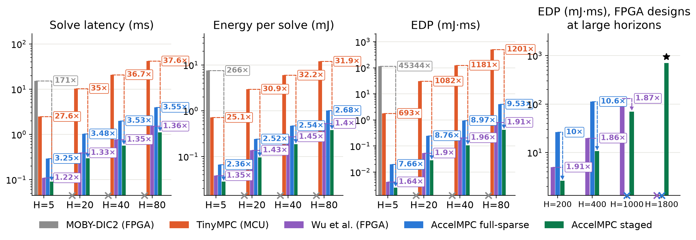
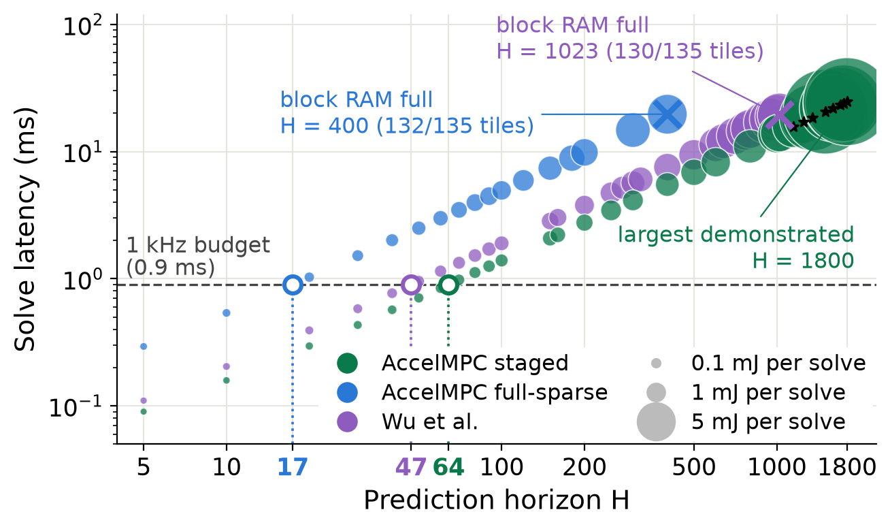
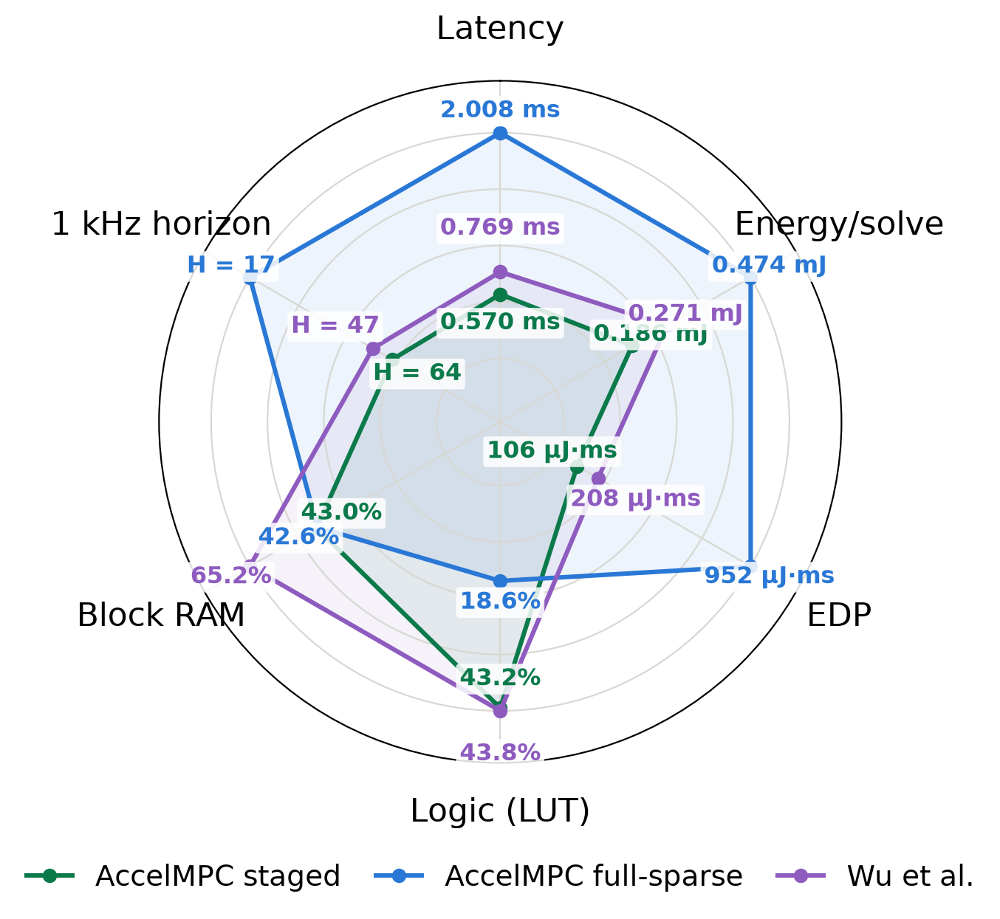
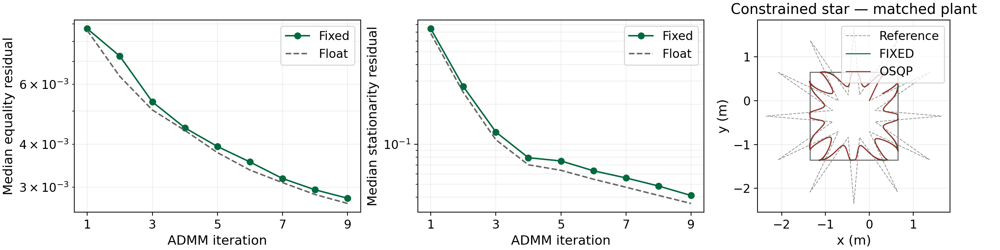
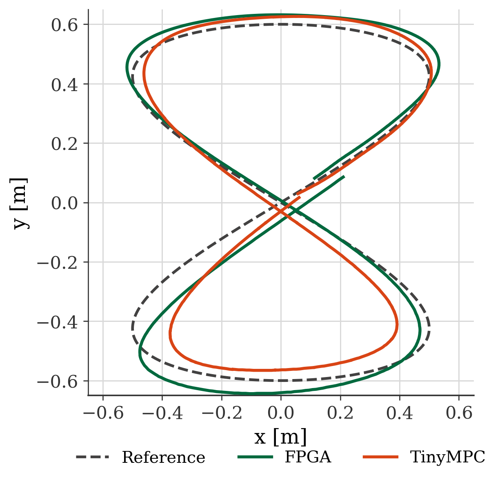
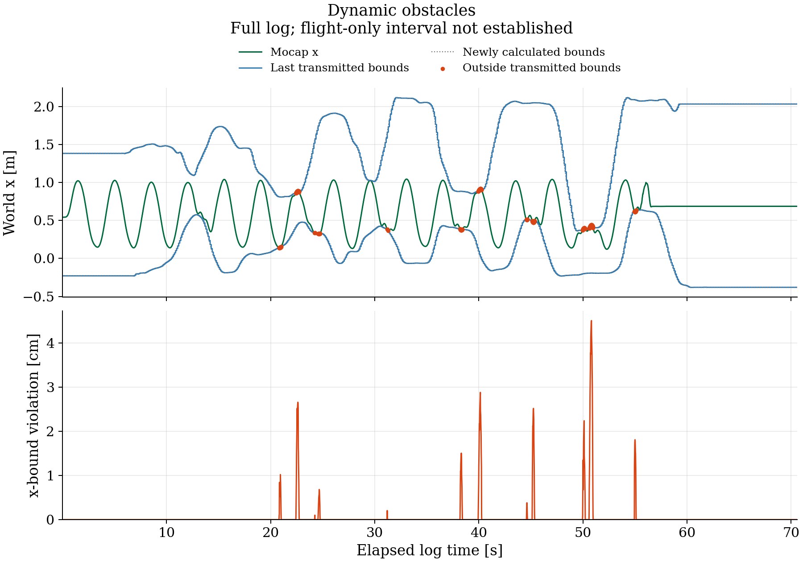

# Evaluation results

These results use the bundled benchmark and flight data, plus the numerical
simulation described below. Preview figures are included in `figures/` so this
page can be read directly on GitHub or in a fresh checkout. Full generated
exports are written to untracked `output/`.

See [regeneration instructions](#regenerate) to recreate the analysis and
[benchmark methodology](../docs/benchmarking.md) for measurement definitions
and the scope of the supplied experiment data.

## Solver benchmarks

The [benchmark CSV](data/benchmarks.csv) contains MCU timing measurements,
implementation estimates and Arty measurements for valid completed points.
The table uses the same row selection as `plot_benchmarks.py`: timing-clean
implementations, lowest latency then lowest power, with the figure's explicit
readability exclusions. The default comparison uses 10 iterations; the
common-horizon resource comparison is H40. Publication plots select compact
`full_sparse` and improved staged (recorded as `staged_fused`; built with
`staged_a`). Historical `full_sparse_original` and `staged_a` rows are excluded.

Both post-route power estimates and Arty measurements are available.
AccelMPC and TinyMPC FPGA (Wu et al.) use measured values where available.
The latency/energy and EDP figures use measured Arty core/BRAM power
plus matching estimated auxiliary/I/O supply contributions (VCCADC excluded because
it is tied to ground in the custom PCB), with energy and EDP calculated using the
campaign's measured solve latency. Bubble positions use measured FPGA
cycle counts where available and synthesis-derived timing otherwise.
TinyMPC MCU uses its recorded timing and a 287.1 mW active-power estimate. Both energy
and EDP exclude communication and board support circuitry. Asterisked bubbles use
post-route estimates for unmeasured configurations. The paper EDP panel also
includes the asterisked staged H1800 estimate. The resource table and maximum-horizon results also use implementation reports;
they do not imply 1 kHz operation at the largest horizons. See [benchmark methodology](../docs/benchmarking.md#energy-and-timing-definitions)
for measurement boundaries and the separate 100 µs feasibility reserve.
The architecture radar uses measured latency and core/BRAM energy plus estimated
auxiliary/I/O energy, matching the EDP comparison. Its BRAM/LUT utilization comes
from uninstrumented solver builds. Its 1 kHz horizon axis uses linear latency
fits, rounded down to the largest integer within the solve budget. The “Logic” axis is LUT
utilization as a percentage of the device's LUT capacity (36.7% staged versus
12.0% full_sparse and 36.5% Wu FPGA at H40); register utilization is reported separately in the table.

The [device power comparison CSV](data/device_power_comparison.csv) records the
current compact full_sparse 50T sweep (`implementation=compact_rhs`). The sweep
has ten timing-clean points from H5 through H225 at 100 MHz and ten iterations,
without measurement instrumentation. It records estimated post-route power,
resources, timing, latency, and source provenance. Power is Vivado total on-chip
power in watts, not a board measurement. Current 100T comparison fields remain
blank until matching estimates are verified; no cross-device power saving is
claimed for these rows. Numeric fields use decimal points.

| Mapping | Artix-7 50T feasibility |
| --- | --- |
| AccelMPC staged | Does not fit (11 tested horizons) |
| Wu et al. FPGA | Does not fit (10 tested horizons) |
| AccelMPC full_sparse | **Timing-clean through H225** |

100 MHz target, ten iterations, no measurement instrumentation. Failed-fit
sweeps cover H5–250; H225 is the largest demonstrated timing-clean horizon.

H225 is the largest demonstrated timing-clean horizon in this 50T sweep.
Full_sparse H250/H275 failed timing, and H300/H350/H400 exceeded LUT-memory
capacity. The current staged mapping failed implementation at all eleven tested
horizons (H5, 10, 20, 30, 40, 50, 100, 150, 200, 225, 250). Failed builds are not
included as successful CSV results.

The evaluated Wu et al. (TinyMPC FPGA) float32 mapping also failed to fit the
50T at all ten confirmed horizons (H5, 10, 20, 30, 40, 50, 100, 150, 200, 250),
with a 100 MHz target, ten iterations, and no measurement instrumentation.
HLS and RTL synthesis succeeded, but Vivado rejected placement with
`DRC UTLZ-1`: every configuration required 136 DSP48E1 blocks, exceeding the
50T's 120 available blocks. These are capacity failures, not timing failures;
there are no post-route power or latency results to add to the CSV. This result
applies to the evaluated mapping, not to all possible mappings of Wu's solver.
The sweep used Vitis/Vivado 2025.2, repository commit
`af621651a2e422b196f57f02a9df6bbf146a0550`, and TinyMPC FPGA upstream commit
`bd1a6bd2348d2659652d0ae315f9eea8fea40c95`.

<!-- BEGIN GENERATED BENCHMARKS -->

| H40 / 10 iterations | Solve (ms) | Energy (mJ) | EDP (mJ·ms) |
| --- | --- | --- | --- |
| AccelMPC staged | 0.570 | 0.186 | 0.106 |
| AccelMPC full-sparse | 2.008 | 0.474 | 0.952 |
| TinyMPC (MCU) | 20.899 | 6.000 | 125.396 |
| Wu et al. FPGA | 0.769 | 0.271 | 0.208 |

| Matched H40 solver resources | LUTs | FFs | BRAM tiles | DSPs |
| --- | --- | --- | --- | --- |
| AccelMPC staged | 23284.0 | 22209.0 | 27.0 | 150.0 |
| AccelMPC full-sparse | 7628.0 | 9911.0 | 26.5 | 80.0 |

| Largest recorded timing-clean horizon | Horizon | Variables | Constraints | Solve (ms) |
| --- | --- | --- | --- | --- |
| AccelMPC staged | 1800 | 28812 | 32412 | 24.683 |
| AccelMPC full-sparse | 400 | 6412 | 7212 | 19.648 |

<!-- END GENERATED BENCHMARKS -->

The paper's benchmark figures come from `evaluation/paper_figures.py`, which reads
`evaluation/data/benchmarks.csv`. Generate them with:

```sh
python evaluation/paper_figures.py
```

PNG and PDF exports go to ignored `evaluation/output/paper_figures/`. Only PNG
previews are tracked in `evaluation/figures/`; copy the PDFs into the paper repository.
The H40 radar uses the CSV's `solver_*` resources from uninstrumented solver
builds. Wu's H40 routed build uses 23,110 LUTs,
27,029 registers, 56 BRAM tiles and 136 DSPs, closes timing at 100 MHz (0.524 ns
setup slack), and its generated solver/header hashes match the measured build.
Latency and energy retain the board measurements. Its 1 kHz horizon is
estimated from a linear latency fit and rounded down to the largest integer
within the 0.9 ms budget. These are estimates, not separately measured points.
The sweep shows selected horizons for readability; the fits use all measured
points through H400. Its endpoint annotations retain the BRAM counts; the last
successful builds do not establish absolute capacity limits.
`plot_benchmarks.py` remains available for the earlier plot layouts and generated
manuscript numbers; it uses the same consolidated dataset.







## Numerical accuracy

The current H27/k9 analysis uses the actual C++ solver and persistent warm starts.
Independent fixed, float and OSQP closed-loop trajectories use a generated
figure-eight and nonlinear plant. The command-error comparison instead replays
identical fixed-rollout inputs through float and OSQP, avoiding trajectory
feedback differences. These are reconstructed simulations, separate from flights.
All three command-error comparisons use the same 25,600 control instants.
Each error is the maximum absolute difference across the
four motor commands.

<!-- BEGIN GENERATED NUMERICS -->

```text
H27 / 9 iterations / figure-eight / persistent warm start

First-command error distribution (normalized motor units):
Per-instant error = max absolute difference across the four motor commands.
Inputs match across solvers at each instant; instants come from one trajectory.
Std is population standard deviation; percentiles use linear interpolation.
Comparison       Samples          Min         Mean          Std       Median          P95          P99          Max
  fixed–float     25600  5.96046e-08  1.85024e-05  1.36375e-05   1.4782e-05  4.72665e-05  4.95911e-05   5.1856e-05
  fixed–OSQP      25600  6.27034e-08  0.000774416  0.000725098  0.000610885   0.00221414   0.00354063   0.00518347
  float–OSQP      25600  3.09876e-09  0.000764815  0.000720861  0.000600955   0.00219602   0.00351816   0.00515903

Controller   Tracking RMSE (m)   Max XY-bound violation (m)
  fixed      0.05672986          0
  float      0.05672938          0
  osqp       0.05663985          0
```

<!-- END GENERATED NUMERICS -->

The numerical simulation command below generates `output/numerical_convergence.png`.
The bundled star result is shown below.

### Constrained-star comparison with OSQP

The star reference contains sharp corners and deliberately extends beyond the
admissible XY box. Tracking error therefore reflects the reference geometry,
constraints and controller dynamics as well as numerical solution accuracy.
To contextualize the recorded flight's tracking error, we compare the fixed-point
and float implementations with OSQP on the same star reference in simulation.
The fixed-point and float solvers use H27/k9 and persistent warm starts; OSQP
solves the same constrained MPC problem to its configured tolerances.

All controllers use the same plant, hard XY bounds and motor limits, and update
at 1 kHz. The plant model is regenerated at 1 ms while the MPC prediction timestep
remains 20 ms. The reference is checked against the star reference CSV. Tracking
RMSE covers the feasible-reference portions of one 25 s cycle: 12,040 of 25,000
samples (48.16%).

| Controller | 3D RMSE (cm) | Max XY violation over full rollout (cm) |
| --- | --- | --- |
| Fixed-point | 19.5297 | 1.3363 |
| Float | 19.4932 | 1.3382 |
| OSQP | 19.6230 | 0.002328 |



The right-hand panel overlays the fixed-point trajectory (green), OSQP trajectory
(red), recorded reference (dashed grey) and hard XY box. The left and middle
panels show fixed-point and float solver residuals. This figure shows simulated
trajectories, not the recorded flight.

The trajectory overlay shows similar corner rounding, and the three controllers
achieve comparable tracking RMSE. Thus, the star's tracking error also occurs
when OSQP solves the MPC problem: it cannot be attributed solely to the FPGA
solver's fixed iteration budget or arithmetic. This supports interpreting the
flight RMSE in the context of this demanding reference, rather than judging
solver quality from its absolute magnitude alone.


## Penalty-parameter sensitivity

`rho_saturation_sweep.py` runs a fixed sweep comparing equality/inequality 
penalties at ten ADMM iterations, using the same figure-eight and star inputs
in float and native `ap_fixed<32,10,AP_RND,AP_SAT>` arithmetic. Inputs are 
regenerated when no valid cache exists; candidate commands are not fed back into the plant.

```bash
OPENBLAS_NUM_THREADS=1 python evaluation/rho_saturation_sweep.py \
  --hls-include /path/to/Vitis/include --jobs 8
```

Requires NumPy, SciPy, scikit-sparse, OSQP, g++, and AMD HLS headers. The full
native sweep is expensive; each invocation evaluates all candidates.
`--output` selects the results directory (default `output/rho_saturation/`).
Production files and installed headers are never modified.

The workload has 64 windows per trajectory, each with up to 32 preceding
inputs: 4,160 replay inputs total. At most four inputs may have any native
saturation (0.1%). Factor saturation and nonfinite values reject a candidate.
Infeasible QPs remain in saturation screening; command error uses 118 feasible
reference QPs. OSQP uses explicit polishing and absolute/relative tolerances
of 1e-7. The ranking metric is mean float first-command infinity-norm error;
fixed arithmetic determines eligibility. Monitoring includes implicit native
saturating conversions and guarded accumulators. Unrestricted rho uses an
evaluation-only wide multiplier; power-of-two rho retains shifts.

| Best tested choice | Equality rho | Inequality rho | Mean float command error |
| --- | ---: | ---: | ---: |
| Power of two | 128 | 32 | 0.01232 |
| Unrestricted | 152.2185 | 38.0546 | 0.01099 |

The relative mean-error increase is **12.04%**.
Selection and reporting use the same trajectories, without held-out validation.

The [candidate CSV](data/rho_saturation_candidates.csv) records the completed
sweep and supplies only the candidate rho columns to fresh runs; all outcomes
are recomputed. New outputs remain under ignored
`output/` and do not replace this bundled evidence automatically.

## Recorded flights

The figure-eight overlay is a trajectory visualization, not a new
synchronized tracking-error measurement.



The following table quantifies **position-constraint violation**. Star values use
the larger of the x/y violations per sample. Dynamic values use the complete dynamic-obstacle
recording and last transmitted x bounds.
RMS includes zero violations; percentages are sample-weighted with repeated
motion-capture frames retained. These values do not measure obstacle clearance.
See [flight methodology and limitations](../docs/flight-analysis.md).

The distribution statistics include zero violations; standard deviation is over
the full evaluated population. “Violation ≤1 cm” includes samples inside the
bounds. These are percentages of logged samples, not continuous-time durations.

<!-- BEGIN GENERATED FLIGHTS -->

| Recording | Samples | Max violation (cm) | RMS violation (cm) | Outside (%) |
| --- | --- | --- | --- | --- |
| dynamic_obstacle | 6639 | 4.5048 | 0.3386 | 3.449 |
| constrained_star | 3752 | 3.1325 | 0.5070 | 11.354 |

| Recording | Inside bounds (%) | Violation ≤1 cm (%) | Mean (cm) | Std (cm) | P95 (cm) | P99 (cm) |
| --- | --- | --- | --- | --- | --- | --- |
| dynamic_obstacle | 96.55 | 97.97 | 0.0502 | 0.3348 | 0.0000 | 2.0244 |
| constrained_star | 88.65 | 94.03 | 0.1417 | 0.4868 | 1.2276 | 2.6178 |

<!-- END GENERATED FLIGHTS -->

STAR tracking error compares the selected flight with the recorded trajectory from
[star_reference.csv](data/flight_metrics/star_reference.csv).
It scores position error only where the aligned reference is inside the static XY
bounds and reports both 3D and XY RMSE. See the
[flight-analysis method](../docs/flight-analysis.md).

<!-- BEGIN GENERATED TRACKING -->

| Recording | Fixed phase / period (s) | Feasible samples (%) | RMSE 3D (cm) | RMSE XY (cm) | P95 3D (cm) | Max 3D (cm) |
| --- | --- | --- | --- | --- | --- | --- |
| constrained_star | 24.343 / 25 | 48.19 | 14.785 | 14.771 | 22.466 | 70.946 |

<!-- END GENERATED TRACKING -->



## Regenerate

### Paper Figure 2

`plot_sparsity.py` outputs the paper's matrix sparsity figure as PDF and PNG
in `evaluation/output/`:

```bash
python evaluation/plot_sparsity.py
```

### Benchmark and flight plots

Run from the repository root with Python 3.10–3.12 in an isolated environment:

```bash
python3 -m venv .venv
source .venv/bin/activate
python -m pip install numpy==1.26.4 matplotlib==3.10.1
python evaluation/paper_figures.py
python evaluation/plot_benchmarks.py
python evaluation/flight_metrics.py
python evaluation/make_top_side_frame_table.py
```

These commands use only bundled CSVs and panel images; no FPGA is required.
The paper script produces the three current benchmark figures. The legacy plot
script produces the earlier layouts, figure-eight overlay and iteration-budget table. The flight script writes text/CSV metrics and trajectory/
bounds figures. The panel script composes the paper's video-frame figure from
tracked PNGs. Original videos are needed only for its optional `--extract-panels`.

To refresh the bundled previews after regenerating the plots:

```bash
mkdir -p evaluation/figures
cp evaluation/output/paper_figures/fig*.png evaluation/figures/
cp evaluation/output/figure8_trajectory_overlay.png evaluation/figures/
cp evaluation/output/dynamic_obstacle_bounds.png evaluation/figures/
```

Include the updated previews when committing analysis changes. Keep full PDF/SVG
exports in `output/`.

Numerical simulation also needs the [build dependencies](../docs/build.md), a
C++14 compiler, AMD's Vitis headers, and OSQP:

```bash
python -m pip install osqp==0.6.7.post3
HLS_INCLUDE=/path/to/Vitis/include OPENBLAS_NUM_THREADS=1 \
  python evaluation/numerical_accuracy.py --simulate
```

Subsequent `python evaluation/numerical_accuracy.py` calls reuse the local
`output/numerical.npz`; use `--simulate` after changing solver or model settings.
The simulation writes a text report and convergence plot, plus
`output/numerical_command_distribution.csv` with distribution statistics and
`output/numerical_command_errors.csv` with per-instant errors and zero-based
control-step indices. These outputs can also be regenerated from the cache.

For the unchanged constrained star, add `--trajectory star --plant matched --simulate` to the
same command. This checks the generated reference against the bundled star CSV
and uses the same hard static box, dynamics constraints and motor limits for all
controllers. The simulated plant uses the MPC model's RK4 integration, hover
linearization and drag correction, regenerated at 1 ms; the controller retains its
20 ms prediction model. There is no added motor lag or plant disturbance. This
uses the same model at different timesteps, not a matrix root or exact equality
between twenty plant steps and one prediction step. The FPGA solver is unchanged.
All controllers update at 1 kHz; OSQP computation adds no simulated delay.
The report includes 3D RMSE over one 25 s cycle, restricted to feasible reference
points, and percentage excess relative to OSQP only if its full rollout succeeds.
Unsolved replay inputs are counted by status; a failed OSQP rollout is saved and
marked incomplete, without a full-cycle RMSE. The tracking definition is given
in the constrained-star comparison above.
The existing convergence figure includes an XY overlay of the reference and
fixed-point/OSQP trajectories.

The existing numerical output files/cache hold the most recent scenario. Use
`--trajectory star --plant matched` to reread its cache, or
`--trajectory fig8 --plant nonlinear --simulate` to regenerate the original
figure-eight scenario before refreshing the tables below.

After regenerating all analyses, refresh the tables with:

```bash
python evaluation/summarize_results.py
```

This last command updates the tables on this page. It does not run
hardware builds or physical experiments. Keep numerical inputs and plotting
styles in the source scripts; exported figures should be regenerated.

## New power measurements

The committed [Arty power measurements](../docs/power.md) report core/BRAM rail power.
Current publication results are consolidated in [benchmarks.csv](data/benchmarks.csv);
use the [Arty comparison workflow](../docs/arty_comparison.md) for new measurements.

MOBY-DIC baseline: see [comparison and reproduction](mobydic/README.md).

TinyMPC FPGA baseline: see [comparison and reproduction](tinympc_fpga/README.md).
