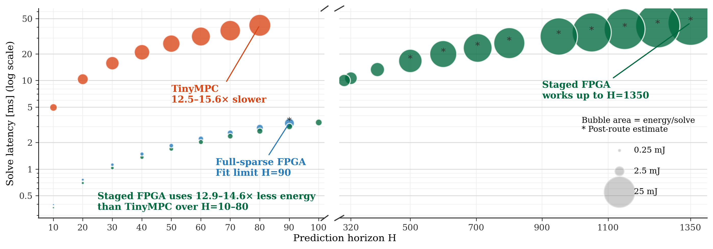
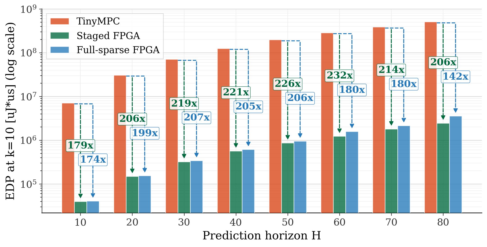
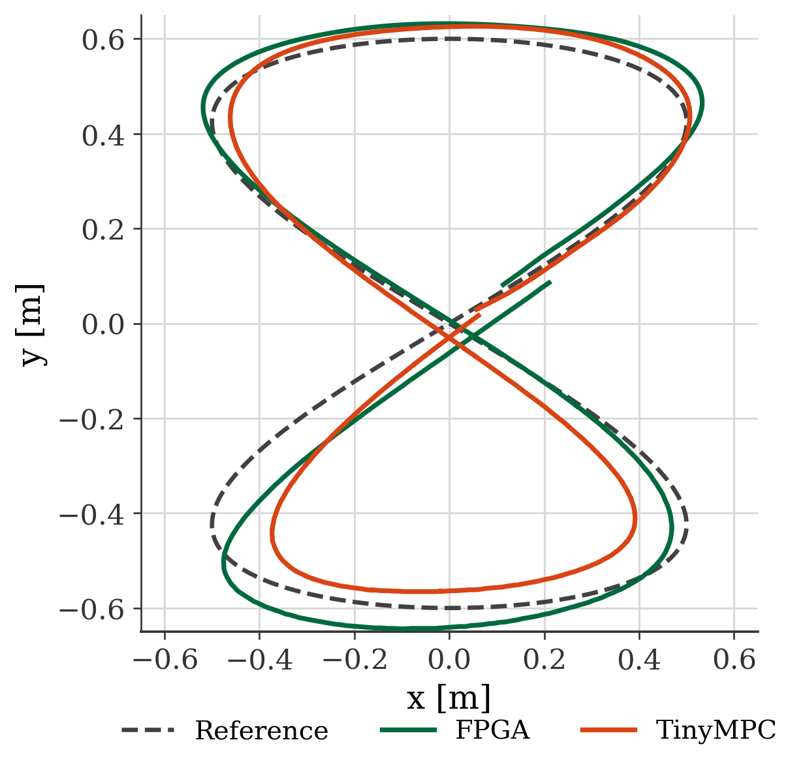
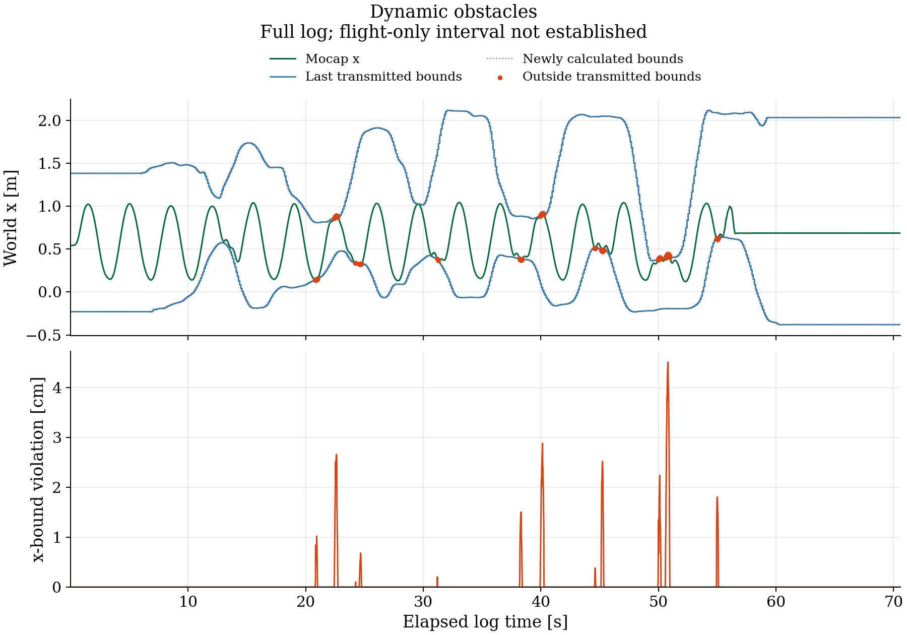

# Evaluation results

These results use the bundled benchmark and flight data, plus the numerical
simulation described below. Preview figures are included in `figures/` so this
page can be read directly on GitHub or in a fresh checkout. Full generated
exports are written to untracked `output/`.

See [regeneration instructions](#regenerate) to recreate the analysis and
[benchmark methodology](../docs/benchmarking.md) for measurement definitions
and the limits of reproducing historical experiments.

## Solver benchmarks

The [benchmark CSV](data/benchmark_summary.csv) contains the historical measurements,
implementation estimates and failed points. The table uses the same row selection
as `plot_benchmarks.py`: timing-clean implementations, lowest latency then lowest
power, with the figure's explicit readability exclusions. The default comparison
uses 10 iterations; the common-horizon resource comparison is H40.

FPGA latency is HLS cycles at 100 MHz, excluding communication. FPGA energy uses
Vivado post-route power estimates; TinyMPC energy uses the stored MCU timings
and a 287.1 mW active-power estimate. EDP is energy times solve delay. See
[benchmark definitions and reproduction](../docs/benchmarking.md) for the power
boundaries, 100 µs feasibility-table reserve, and historical source limitations.
The maximum-horizon results describe capacity, not 1 kHz operation.

<!-- BEGIN GENERATED BENCHMARKS -->

| H40 / 10 iterations | Solve (ms) | Energy (mJ) | EDP (mJ·ms) |
| --- | --- | --- | --- |
| Staged FPGA | 1.365 | 0.932 | 1.273 |
| Full-sparse FPGA | 1.485 | 0.494 | 0.734 |
| TinyMPC | 20.899 | 6.000 | 125.396 |

| H40 FPGA resources | LUTs | FFs | BRAM tiles | DSPs |
| --- | --- | --- | --- | --- |
| Staged FPGA | 22127 | 26540 | 36 | 80 |
| Full-sparse FPGA | 9280 | 12051 | 78.5 | 77 |

| Largest recorded timing-clean horizon | Horizon | Variables | Constraints | Solve (ms) |
| --- | --- | --- | --- | --- |
| Full-sparse FPGA | 90 | 1452 | 1632 | 3.295 |
| Staged FPGA | 1350 | 21612 | 24312 | 44.859 |

<!-- END GENERATED BENCHMARKS -->





## Numerical accuracy

The current H27/k9 analysis uses the actual C++ solver and persistent warm starts.
Independent fixed, float and OSQP closed-loop trajectories use a generated
figure-eight and nonlinear plant. The command-error comparison instead replays
identical fixed-rollout inputs through float and OSQP, avoiding trajectory
feedback differences. These are reconstructed simulations, separate from flights.
All three command-error comparisons use the same 25,600 control instants.
Each error is the maximum absolute difference across the
four motor commands.

<!-- BEGIN GENERATED NUMERICS -->

```text
H27 / 9 iterations / figure-eight / persistent warm start

First-command error distribution (normalized motor units):
Per-instant error = max absolute difference across the four motor commands.
Inputs match across solvers at each instant; instants come from one trajectory.
Std is population standard deviation; percentiles use linear interpolation.
Comparison       Samples          Min         Mean          Std       Median          P95          P99          Max
  fixed–float     25600  5.96046e-08  1.85024e-05  1.36375e-05   1.4782e-05  4.72665e-05  4.95911e-05   5.1856e-05
  fixed–OSQP      25600  6.27034e-08  0.000774416  0.000725098  0.000610885   0.00221414   0.00354063   0.00518347
  float–OSQP      25600  3.09876e-09  0.000764815  0.000720861  0.000600955   0.00219602   0.00351816   0.00515903

Controller   Tracking RMSE (m)   Max XY-bound violation (m)
  fixed      0.05672986          0
  float      0.05672938          0
  osqp       0.05663985          0
```

<!-- END GENERATED NUMERICS -->

The convergence plot is generated locally as `output/numerical_convergence.png`
by the numerical simulation command below; it is not bundled with this page.

## Recorded flights

The figure-eight overlay is a trajectory visualization, not a new
synchronized tracking-error measurement.



The following table quantifies **position-constraint violation**. Star values use
the larger of the x/y violations per sample. Dynamic values use the complete dynamic-obstacle
recording and last transmitted x bounds.
RMS includes zero violations; percentages are sample-weighted with repeated
motion-capture frames retained. These values do not measure obstacle clearance.
See [flight methodology and limitations](../docs/flight-analysis.md).

The distribution statistics include zero violations; standard deviation is over
the full evaluated population. “Violation ≤1 cm” includes samples inside the
bounds. These are percentages of logged samples, not continuous-time durations.

<!-- BEGIN GENERATED FLIGHTS -->

| Recording | Samples | Max violation (cm) | RMS violation (cm) | Outside (%) |
| --- | --- | --- | --- | --- |
| dynamic_obstacle | 6639 | 4.5048 | 0.3386 | 3.449 |
| constrained_star | 3752 | 3.1325 | 0.5070 | 11.354 |

| Recording | Inside bounds (%) | Violation ≤1 cm (%) | Mean (cm) | Std (cm) | P95 (cm) | P99 (cm) |
| --- | --- | --- | --- | --- | --- | --- |
| dynamic_obstacle | 96.55 | 97.97 | 0.0502 | 0.3348 | 0.0000 | 2.0244 |
| constrained_star | 88.65 | 94.03 | 0.1417 | 0.4868 | 1.2276 | 2.6178 |

<!-- END GENERATED FLIGHTS -->

STAR tracking error compares the selected flight with the recorded trajectory from
[star_reference.csv](data/flight_metrics/star_reference.csv).
It scores position error only where the aligned reference is inside the static XY
bounds and reports both 3D and XY RMSE. See the
[flight-analysis method](../docs/flight-analysis.md).


<!-- BEGIN GENERATED TRACKING -->

| Recording | Fixed phase / period (s) | Feasible samples (%) | RMSE 3D (cm) | RMSE XY (cm) | P95 3D (cm) | Max 3D (cm) |
| --- | --- | --- | --- | --- | --- | --- |
| constrained_star | 24.343 / 25 | 48.19 | 14.785 | 14.771 | 22.466 | 70.946 |

<!-- END GENERATED TRACKING -->



## Regenerate

Run from the repository root with Python 3.10–3.12 in an isolated environment:

```bash
python3 -m venv .venv
source .venv/bin/activate
python -m pip install numpy==1.26.4 matplotlib==3.10.1
python evaluation/plot_benchmarks.py
python evaluation/flight_metrics.py
python evaluation/make_top_side_frame_table.py
```

These commands use only bundled CSVs and panel images; no FPGA is required.
The first produces latency/energy, EDP, H40 radar, figure-eight overlay and the
iteration-budget table. The flight script writes text/CSV metrics and trajectory/
bounds figures. The panel script composes the paper's video-frame figure from
tracked PNGs. Original videos are needed only for its optional `--extract-panels`.

To refresh the four bundled previews after regenerating the plots:

```bash
mkdir -p evaluation/figures
cp evaluation/output/benchmark_latency_energy.png evaluation/figures/
cp evaluation/output/benchmark_edp_bars.png evaluation/figures/
cp evaluation/output/figure8_trajectory_overlay.png evaluation/figures/
cp evaluation/output/dynamic_obstacle_bounds.png evaluation/figures/
```

Include the updated previews when committing analysis changes. Keep full PDF/SVG
exports in `output/`.

Numerical simulation also needs the [build dependencies](../docs/build.md), a
C++14 compiler, AMD's Vitis headers, and OSQP:

```bash
python -m pip install osqp==0.6.7.post3
HLS_INCLUDE=/path/to/Vitis/include OPENBLAS_NUM_THREADS=1 \
  python evaluation/numerical_accuracy.py --simulate
```

Subsequent `python evaluation/numerical_accuracy.py` calls reuse the local
`output/numerical.npz`; use `--simulate` after changing solver or model settings.
The simulation writes a text report and convergence plot, plus
`output/numerical_command_distribution.csv` with distribution statistics and
`output/numerical_command_errors.csv` with per-instant errors and zero-based
control-step indices. These outputs can also be regenerated from the cache.

After regenerating all analyses, refresh the tables with:

```bash
python evaluation/summarize_results.py
```

This last command updates the tables on this page. It does not run
hardware builds or physical experiments. Keep numerical inputs and plotting
styles in the source scripts; exported figures should be regenerated.

## New power measurements

The committed [Arty power measurements](../docs/power.md) report core/BRAM rail power.
The [Arty power measurements CSV](data/arty_power_measurements.csv) contains the
campaign summary for 42 planned configurations: 23 measured with three valid
repetitions each and 19 marked pending.
